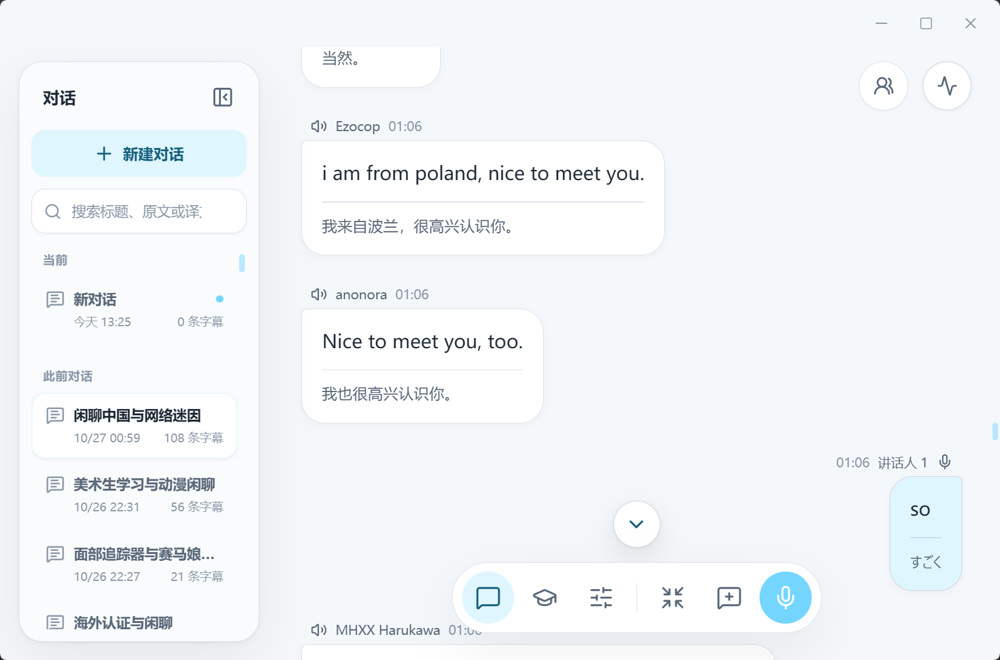

<p align="center">
    
</p>

<p align="center">
    VRCS は VRChat 向けの字幕・翻訳・言語学習・AI ツールです。
</p>

<p align="center">
    
    
    
</p>

<p align="center">
    <a href="README.md">English</a> | <a href="README.zh-CN.md">简体中文</a> | <a href="README.zh-Hant.md">繁體中文</a> | <strong>日本語</strong>
</p>

<p align="center">
    <a href="https://github.com/Dreaminko/VRCS/releases/latest">ダウンロード</a> · <a href="https://github.com/Dreaminko/VRCS/issues">問題を報告</a> · <a href="docs/CONTRIBUTING.md">コントリビュート</a> · <a href="https://discord.gg/aCDnfX7paC">Discord</a> · <a href="https://qm.qq.com/q/i9kOOxFn44">QQ グループ</a>
</p>



## インストール

- **Windows（`x64`）**：[GitHub Releases](https://github.com/Dreaminko/VRCS/releases) から `VRCS-<version>-windows-x64.exe` をダウンロードします。Windows 10 / 11 と [Microsoft Visual C++ v14 Redistributable（x64）](https://aka.ms/vs/17/release/vc_redist.x64.exe) が必要です。
- **Linux（`x86_64`）**：[GitHub Releases](https://github.com/Dreaminko/VRCS/releases) から `.deb`、`.rpm`、または `AppImage` を入手するか、AUR から [`vrcs-bin`](https://aur.archlinux.org/packages/vrcs-bin)（`yay -S vrcs-bin` / `paru -S vrcs-bin`）をインストールします。PipeWire と Secret Service を使用し、GPU アクセラレーションにはシステムの Vulkan ローダーとドライバーが必要です。
- **アップデート**：Windows と AppImage はアプリ内アップデートに対応し、「設定 › システム › ソフトウェア更新」の「Nightly の更新を受け取る」から Nightly 版も試せます。`.deb`、`.rpm`、AUR（`vrcs-bin`）はパッケージマネージャーから更新してください。

## 主な機能

- **2 系統のリアルタイム字幕**：システム音声または VRChat プロセス音声とマイク音声を同時に取り込み、個別制御、コンパクトウィンドウ、ローカルのセッション履歴に対応したリアルタイム字幕を生成します。
- **音声認識と区間分割**：CPU または Vulkan で動作するローカル Qwen3 ASR に加え、Qwen3 ASR、Fun-ASR、OpenAI Realtime、Gemini、Groq、OpenRouter、Xiaomi MiMo などのクラウドサービスに対応。Silero VAD と任意の Smart Turn による音声区切りを利用できます。
- **柔軟な翻訳**：音声ソースごとに最大 3 言語へ手動・自動翻訳でき、言語ごとにサービスとモデルを選択できます。オフラインのローカル PLaMo（CPU）翻訳のほか、DeepL、Microsoft Translator、OpenAI、Gemini、Alibaba Cloud、DeepSeek、Ollama、LM Studio、OpenAI 互換エンドポイントに対応しています。
- **リアルタイム音声直接翻訳**：Qwen Live Translate、Gemini Live Translate、OpenAI Realtime Translation を利用して、リアルタイムの原文と訳文を直接生成します。
- **コンテキストと用語管理**：プロンプトのカスタマイズ、ローカル・購読用語集、ルームや字幕のコンテキスト（VRChat のローカルログまたはネットワークキャプチャから取得）、任意の [VRCX-0](https://vrcx-0.dev/) ワールド・メンバー連携に対応し、言語プリセットで認識・翻訳・Chatbox 設定をまとめて切り替えられます。
- **会話管理**：終了した会話の AI 要約タイトルを生成し、タイトルで履歴を検索できます。デフォルトは無効で、「設定 › システム › 会話管理」と「設定 › API とモデル」でモデル設定と自動生成を有効化できるほか、履歴メニューから手動生成・再生成も可能です。手動で付けた名前は常に優先されます。
- **VRChat OSC Chatbox 出力**：マイク字幕と訳文を VRChat Chatbox に送信します。クイック入力、翻訳プレビュー、多言語出力、任意の OSCQuery ミュート同期に対応しています。
- **UniText プロップ出力**：マイク字幕や他のプレイヤーの字幕・訳文をアバターに導入した [UniText](https://github.com/Dreaminko/UniText) プロップに表示します。OSCQuery による自動検出と OSC 送信、パラメータティア選択、原文併記の切り替え、マイクミュート同期、無操作時の自動クリアに対応しています。
- **VR オーバーレイ（SteamVR / OpenXR & OpenVR）**：Windows と Linux（`x86_64`）の両方で、VR ヘッドセット内や手首パネルで多言語字幕を閲覧でき、VR ダッシュボードから字幕のレイアウト、言語、Chatbox 設定を直接調整できます。
- **OCR 翻訳**：デスクトップ（Windows および Linux の Screenshot Portal 経由）や VR（Windows）で文字を範囲選択し、ローカル PP-OCRv6（CPU、Windows では DirectML GPU にも対応）で文字認識と翻訳を実行します。結果はデスクトップウィンドウ、手首パネル、または VR 内の原文位置に表示できます。
- **画像質問応答**：デスクトップ（Windows および Linux の Screenshot Portal 経由）や VR（Windows）で選択した画像領域について質問できます。デスクトップでは文字入力または音声入力、VR では左トリガーを押しながら音声で質問でき、回答は専用ウィンドウや Markdown 対応の手首パネルに表示されます（OCR の有効化は不要です）。*（上流の OpenXR / Monado シーンキャプチャ API が未整備のため、VR OCR と VR 画像質問応答は現在 Windows のみ対応しています。）*
- **言語学習と Anki 連携**：Yomitan 辞書をインポートし、字幕から直接辞書検索や「AI に質問」、語義解説、文型分析、会話レビューを行えます。単語・文型・穴埋めカードを編集し、AnkiConnect 経由で Anki へ送信できます。

### 実験的な VRChat ネットワークキャプチャ

- **VRChat プレイヤー別独立音声トラック（実験的）**：「設定 › キャプチャ」で有効にすると、プレイヤーごとに音声認識・翻訳を行い、処理対象の絞り込み（任意の「視界内のプレイヤーを優先（試験的）」に対応）やデスクトップ・VR 字幕での発話者表示を行えます。
- **VRChat Chatbox を受信して翻訳（実験的）**：「設定 › キャプチャ」で「VRChat Chatbox を受信して翻訳」を有効にできます（デフォルトは無効）。実際の受信は全体のキャプチャ開始・停止ボタンと連動し、他の音声やマイクを無効にすれば ASR や VAD を使わないテキスト専用モードとして動作します。自動翻訳には「相手の発言の翻訳先」に設定されたテキスト翻訳サービスが使われ（リアルタイム音声翻訳は代用不可）、受信したメッセージが OSC 経由で VRChat に送り返されることはありません。
- **利用要件**：上記 2 機能は実験的な「VRChat ネットワークキャプチャ」バックエンドを共有しています。
  - **Windows**：管理者権限での実行、ページファイルが配置されているドライブの選択、および Windows メモリ圧縮の無効化（変更後に PC の再起動が必要）が求められます。
  - **Linux（`x86_64`）**：システムパッケージのインストール（`.deb`、`.rpm`、または AUR `vrcs-bin`。`/usr/bin/vrcs-desktop` と polkit ポリシーが導入されます）、グラフィカルセッション内で動作中の polkit 認証エージェント、およびプレイヤー別音声用のシステム Opus（`libopus0` / `opus`）が必要です。AppImage にはシステムバイナリとポリシーが含まれないため、システムパッケージを使用するか [CONTRIBUTING.md](docs/CONTRIBUTING.md#linux-development-initial-adaptation) の手順に従って手動で配置してください。
  - 有効化する前に、アプリ内の利用規約・プライバシー・アカウントリスクに関する案内をご確認ください。

## プライバシー

VRCS は元の音声を保存しません。字幕履歴、学習項目、辞書、設定はデフォルトでローカルに保存されます。ローカル Qwen ASR、ローカル PLaMo 翻訳、ローカル OCR は音声・テキスト・画像を端末内で処理します。クラウド音声認識は音声区間を選択したプロバイダーに送信します。

クラウド翻訳、学習分析、「AI に質問」では、関連テキスト、明示的に選択したコンテキスト、および送信した質問が設定済みのサービスへ送信されます。ローカル認識後のテキストが外部に送信されるかどうかは、選択した翻訳・AI サービスに依存します（ローカル PLaMo を選んだ場合、翻訳も端末内で完結します）。

会話タイトルの生成では、対象の会話の字幕原文の一部または全部を選択したモデルサービスへ送信します（利用料金が発生する場合があります）。訳文、元の音声、他の会話は送信されません。長い会話はサンプリングされ、過去の履歴を自動で一括処理することはありません。

デスクトップ OCR と画像質問応答は選択範囲のみを処理します。画像質問応答は選択した画像と質問文を設定済みのモデルサービスに送信し、質問入力にクラウド音声認識を使う場合は音声も認識サービスへ送信されます。画像と問答はデフォルトでディスクや履歴に保存されず、音声認識と画像リクエストは個別に課金される場合があります。

## 開発

Windows 10 / 11（または Linux `x86_64`）、Node.js 24+、Rustup（バージョンとコンポーネントは `rust-toolchain.toml` を参照）、`PATH` に追加した CMake、および Windows 環境では Visual Studio Build Tools の「C++ によるデスクトップ開発」ワークロードが必要です。

リポジトリのルートで PowerShell（Windows）を開き、実行します。

```powershell
npm install
npm run dev
```

デフォルトのビルドはローカル Qwen ASR に CPU を使用します。Vulkan アクセラレーションを使う場合は `npm run dev:vulkan` を実行してください。ローダーは自動で準備されるため、GPU SDK やシェーダーコンパイラーは不要です。ローカルのランタイムとモデルは「設定 › API とモデル › ローカルモデル」からダウンロードします。独立したバックエンドの開発は [Core README](core/README.md) を参照してください。

Linux（`x86_64`）で開発する場合は、`bash scripts/install-linux-deps.sh` でシステム依存パッケージを導入した上で `npm ci` を実行し、`npm run dev` または `npm run dev:vulkan` で起動してください。Linux ビルドの詳細とネットワークキャプチャ開発手順は [CONTRIBUTING.md](docs/CONTRIBUTING.md#linux-development-initial-adaptation) を参照してください。

変更に応じたチェックを実行します。

```powershell
npm run check:i18n
npm --workspace apps/desktop test
npm run build:frontend
.\scripts\check-rust.ps1
```

Rust スクリプトはワークスペース内の全 crate に対してフォーマット確認、Clippy、テストを実行します。Vulkan 関連の変更には `-Vulkan` を付けてください。

CPU と Vulkan の両方に対応した Windows インストーラーをビルドします。

```powershell
npm run build
```

コントリビュートの詳細は [CONTRIBUTING.md](docs/CONTRIBUTING.md)、UI の翻訳については [LOCALIZATION.md](docs/LOCALIZATION.md) を参照してください。

## ライセンス

[GNU Affero General Public License v3.0](LICENSE)（`AGPL-3.0-only`）。サードパーティのライセンスは [THIRD_PARTY_NOTICES.md](docs/THIRD_PARTY_NOTICES.md) を参照してください。
