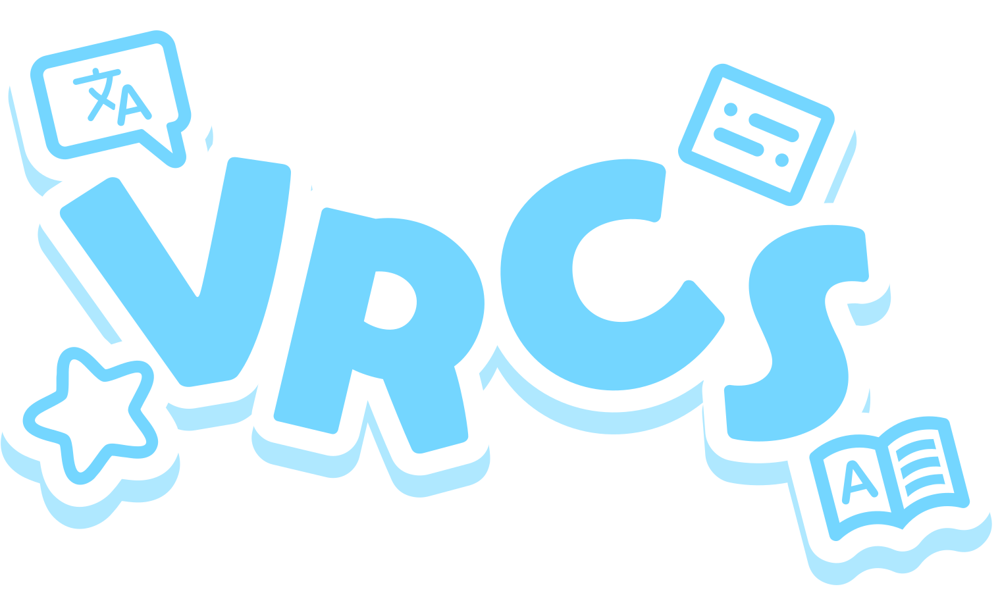
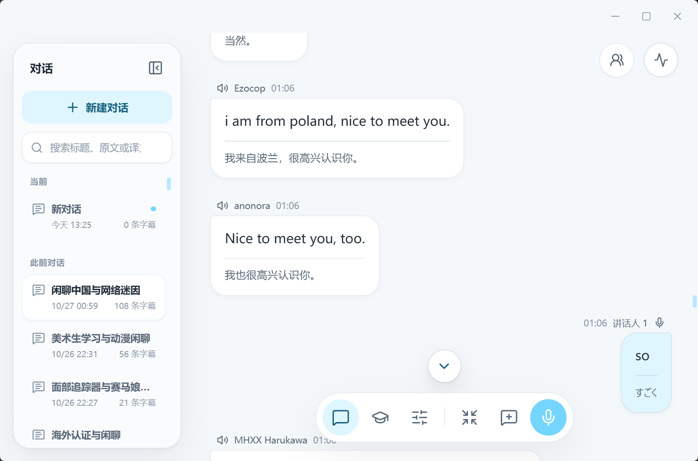

<p align="center">
    
</p>

<p align="center">
    VRCS is a subtitle, translation, language learning, and AI tool for VRChat.
</p>

<p align="center">
    
    
    
</p>

<p align="center">
    <strong>English</strong> | <a href="README.zh-CN.md">简体中文</a> | <a href="README.zh-Hant.md">繁體中文</a> | <a href="README.ja-JP.md">日本語</a>
</p>

<p align="center">
    <a href="https://github.com/Dreaminko/VRCS/releases/latest">Download</a> · <a href="https://github.com/Dreaminko/VRCS/issues">Report an issue</a> · <a href="docs/CONTRIBUTING.md">Contribute</a> · <a href="https://discord.gg/aCDnfX7paC">Discord</a> · <a href="https://qm.qq.com/q/i9kOOxFn44">QQ Group</a>
</p>



## Installation

- **Windows (`x64`)**: Download `VRCS-<version>-windows-x64.exe` from [GitHub Releases](https://github.com/Dreaminko/VRCS/releases). Requires Windows 10 or 11 and [Microsoft Visual C++ v14 Redistributable (x64)](https://aka.ms/vs/17/release/vc_redist.x64.exe).
- **Linux (`x86_64`)**: Download `.deb`, `.rpm`, or `AppImage` from [GitHub Releases](https://github.com/Dreaminko/VRCS/releases), or install [`vrcs-bin`](https://aur.archlinux.org/packages/vrcs-bin) from the AUR (`yay -S vrcs-bin` / `paru -S vrcs-bin`). Uses PipeWire and Secret Service; GPU acceleration requires a system Vulkan loader and driver.
- **Updates**: Windows and AppImage support in-app updates, with optional Nightly builds under **Settings › System › Software updates** (`Receive Nightly updates`). `.deb`, `.rpm`, and AUR (`vrcs-bin`) update through your package manager.

## Features

- **Dual-stream real-time subtitles**: Capture system or VRChat process audio alongside your microphone with independent audio controls, a compact overlay window, and local session history.
- **Speech recognition & segmentation**: Run local Qwen3 ASR (CPU or Vulkan) or connect to cloud services including Qwen3 ASR, Fun-ASR, OpenAI Realtime, Gemini, Groq, OpenRouter, and Xiaomi MiMo, paired with Silero VAD and optional Smart Turn semantic endpointing.
- **Flexible translation**: Translate each audio stream manually or automatically into up to three languages with per-language service and model selection. Supports offline local PLaMo (CPU) alongside DeepL, Microsoft Translator, OpenAI, Gemini, Alibaba Cloud, DeepSeek, Ollama, LM Studio, and OpenAI-compatible endpoints.
- **Live audio translation**: Generate real-time source captions and translations directly with Qwen Live Translate, Gemini Live Translate, or OpenAI Realtime Translation.
- **Context & terminology**: Customize prompts, local and subscribed glossaries, room and subtitle context (using VRChat logs or active network capture), optional [VRCX-0](https://vrcx-0.dev/) world and member data, and language presets to switch recognition, translation, and Chatbox settings together.
- **Conversation management**: Generate AI summary titles for completed conversations and search history by title. Off by default; configure a model and auto-generation in **Settings › System › Conversation management** and **Settings › API and models**, or generate and regenerate titles from a history item's menu. Custom titles always take priority.
- **VRChat OSC Chatbox output**: Send microphone subtitles and translations to the VRChat Chatbox with quick input, translation preview, multilingual output, and optional OSCQuery mute synchronization.
- **UniText avatar prop output**: Display your microphone subtitles, other players' captions, and translations on an avatar-mounted [UniText](https://github.com/Dreaminko/UniText) prop via OSCQuery auto-detection and OSC, with selectable parameter tiers, optional original text, mute synchronization, and idle auto-clear.
- **VR overlay (SteamVR / OpenXR & OpenVR)**: Read multilingual subtitles in your headset or on your wrist, and adjust subtitle layout, target languages, and Chatbox settings directly from the VR dashboard on Windows and Linux (`x86_64`).
- **OCR translation**: Select text on your desktop (Windows and Linux via Screenshot Portal) or in VR (Windows) using local PP-OCRv6 (CPU, plus DirectML GPU on Windows) and view translations in a desktop window, on your wrist, or overlaid on the source text in VR.
- **Visual Q&A**: Ask questions about selected regions on your desktop (Windows and Linux via Screenshot Portal) or in VR (Windows)—type or dictate on desktop, or hold the left trigger to speak in VR. Answers open in a separate window or a Markdown-capable wrist panel without requiring OCR. *(VR OCR and VR visual Q&A are currently Windows-only, as Linux VR scene capture awaits upstream OpenXR/Monado APIs.)*
- **Language learning & Anki**: Import Yomitan dictionaries, look up words or **Ask AI** directly from subtitles, review definitions, sentence patterns, and conversations, and edit vocabulary, sentence-pattern, or cloze cards to export via AnkiConnect.

### Experimental VRChat network capture

- **VRChat per-player independent tracks (Experimental)**: Enable in **Settings › Capture** to recognize and translate each player separately, choose which players to process (with optional **Prioritize players in view (experimental)**), and show named captions on desktop and in VR.
- **Receive and translate VRChat Chatbox (Experimental)**: Enable **Receive and translate VRChat Chatbox** in **Settings › Capture** (off by default). Reception follows the global capture start/stop toggle and can run in text-only mode by turning off other audio and microphone capture—no ASR or VAD required. Auto-translation uses the other-players target language with a text translation service (live audio translation services cannot replace text translation), and received messages are never echoed back to VRChat via OSC.
- **Requirements**: Both features share the experimental **VRChat network capture** backend.
  - **Windows**: Requires administrator privileges, selecting the active pagefile drive, and disabling Windows Memory Compression (which requires restarting your PC).
  - **Linux (`x86_64`)**: Requires a system package installation (`.deb`, `.rpm`, or AUR `vrcs-bin`, which provides `/usr/bin/vrcs-desktop` and its polkit policy), a running polkit authentication agent in your graphical session, and system Opus (`libopus0` / `opus`) for per-player audio. AppImage does not install the system binary or polkit policy; use a system package or follow the manual setup in [CONTRIBUTING.md](docs/CONTRIBUTING.md#linux-development-initial-adaptation).
  - Please review the in-app terms, privacy, and account-risk notice before enabling.

## Privacy

VRCS does not save raw audio. Subtitle history, learning items, dictionaries, and settings are stored locally by default. Local Qwen ASR, local PLaMo translation, and local OCR process audio, text, and images on your device; cloud speech recognition sends speech segments to the selected provider.

Cloud translation, learning analysis, and Ask AI send relevant text, explicitly selected context, and submitted questions to the configured service. Whether locally recognized text stays on-device or leaves your machine depends on the translation and AI services you choose.

Conversation title generation sends part or all of a conversation's original transcript to the selected model service (provider charges may apply). Translations, raw audio, and other conversations are excluded; long transcripts are sampled, and existing history is never batch-processed automatically.

Desktop OCR and visual Q&A process only the selected region. Visual Q&A sends the captured image and question text to the configured model service (and sends spoken audio to cloud ASR if cloud speech recognition is used). Images and Q&A exchanges are not saved to disk or history by default, and speech recognition and image requests may incur separate charges.

## Development

Requirements: Windows 10 or 11 (or Linux `x86_64`), Node.js 24+, Rustup with the toolchain and components in `rust-toolchain.toml`, and CMake on `PATH` (plus Visual Studio Build Tools with **Desktop development with C++** on Windows).

Run from the repository root in PowerShell (Windows):

```powershell
npm install
npm run dev
```

The default build uses CPU for local Qwen ASR. Use `npm run dev:vulkan` for Vulkan acceleration; the loader is prepared automatically with no GPU SDK or shader compiler required. Download local runtimes and models inside **Settings › API and models › Local models**. For standalone backend development, see [Core README](core/README.md).

On Linux (`x86_64`), install system build dependencies with `bash scripts/install-linux-deps.sh`, run `npm ci`, and start with `npm run dev` or `npm run dev:vulkan`. See [CONTRIBUTING.md](docs/CONTRIBUTING.md#linux-development-initial-adaptation) for Linux build prerequisites and network-capture development details.

Run the checks relevant to your changes:

```powershell
npm run check:i18n
npm --workspace apps/desktop test
npm run build:frontend
.\scripts\check-rust.ps1
```

The Rust script runs formatting, Clippy, and tests across all workspace crates; add `-Vulkan` for Vulkan-related changes.

Build the Windows installer with CPU and Vulkan support:

```powershell
npm run build
```

See [CONTRIBUTING.md](docs/CONTRIBUTING.md) for contribution guidelines and [LOCALIZATION.md](docs/LOCALIZATION.md) for interface translations.

## License

[GNU Affero General Public License v3.0](LICENSE) (`AGPL-3.0-only`). Third-party licenses are listed in [THIRD_PARTY_NOTICES.md](docs/THIRD_PARTY_NOTICES.md).
