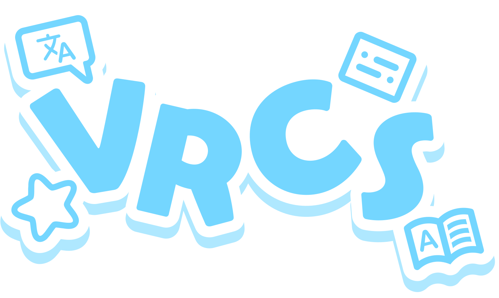
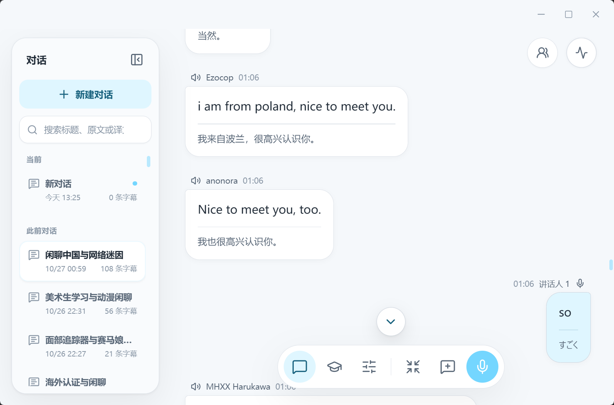

<p align="center">
    
</p>

<p align="center">
    VRCS 是面向 VRChat 的字幕、翻译、语言学习与 AI 工具。
</p>

<p align="center">
    
    
    
</p>

<p align="center">
    <a href="README.md">English</a> | <strong>简体中文</strong> | <a href="README.zh-Hant.md">繁體中文</a> | <a href="README.ja-JP.md">日本語</a>
</p>

<p align="center">
    <a href="https://github.com/Dreaminko/VRCS/releases/latest">下载</a> · <a href="https://github.com/Dreaminko/VRCS/issues">问题反馈</a> · <a href="CONTRIBUTING.md">参与贡献</a> · <a href="https://discord.gg/53H872eYq">Discord</a> · <a href="https://qm.qq.com/q/i9kOOxFn44">QQ 群</a>
</p>



## 安装

从 [GitHub Releases](https://github.com/Dreaminko/VRCS/releases) 下载 `VRCS-<version>-windows-x64.exe`。

- Windows 10 / 11，需安装 [Microsoft Visual C++ v14 Redistributable（x64）](https://aka.ms/vs/17/release/vc_redist.x64.exe)。
- 本地 Qwen ASR 支持 CPU 或 Vulkan，请在识别设置中下载运行组件和模型。
- 首次使用需联网下载 Silero VAD 模型；启用语义断句时还需下载 Smart Turn 模型。
- 云端识别、翻译和学习分析需要对应服务商的 API 凭据，服务商可能收取费用。
- OCR 需下载本地 PP-OCRv6 模型。

## 首次使用

1. 按设置向导选择语言，以及本地或云端识别。
2. 选择系统音频、VRChat 进程音频或麦克风，测试麦克风并调整语音触发阈值。
3. 开始转写，按需启用翻译、Chatbox 输出或 SteamVR 字幕。

可从“设置 › 系统”重新运行向导。

可在“设置 › 系统 › 功能选项”关闭不使用的功能，隐藏相关设置和入口，保留已有配置与数据。

## 主要功能

- 采集系统或 VRChat 进程音频与麦克风，生成双路实时字幕，支持独立音源控制、紧凑窗口和本地会话历史。
- 为已结束的会话生成 AI 总结标题，并按标题查找历史。可在“设置 › 系统 › 会话管理”配置模型并开启自动生成，默认关闭；新建对话会结束旧会话，停止转写仅暂停。也可在历史会话菜单中手动生成或重新生成，手动命名始终优先。
- 本地 Qwen3 ASR 支持 CPU 或 Vulkan；云端识别支持 Qwen3 ASR、Fun-ASR、OpenAI Realtime、Gemini、Groq 和 OpenRouter 等服务，配合 Silero VAD 与可选 Smart Turn 进行语音分段。
- 每路音源最多翻译为三种语言，可分别选择服务与模型，支持手动或自动翻译，以及 DeepL、Microsoft Translator、OpenAI、Gemini、Alibaba Cloud LLM 和 OpenAI 兼容服务。
- Qwen Live Translate、Gemini Live Translate和 OpenAI Realtime Translation 直接生成实时原文与译文。
- 自定义提示词、本地与订阅术语表、字幕上下文，可接入 [VRCX-0](https://vrcx-0.dev/) 的世界与成员信息，通过语言预设切换识别、翻译和 Chatbox 设置。
- 将麦克风字幕和译文发送到 VRChat OSC Chatbox，支持快速输入、翻译预览、多语言输出和可选的 OSCQuery 静音同步。
- 在 SteamVR 头显或手腕上阅读多语言字幕，通过仪表盘调整字幕布局、语言和 Chatbox 设置。
- 在桌面或 VR 中框选文字进行 OCR 翻译，使用本地 PP-OCRv6（CPU / DirectML GPU），结果可显示在桌面窗口、手腕面板或 VR 原文位置。

https://github.com/user-attachments/assets/aa57a9d3-def5-47ad-ba5b-2af792f54349

- 对桌面或 VR 中的选区图片提问：桌面支持键入或语音输入，VR 中按住左扳机讲话。回答显示在独立窗口或支持 Markdown 的手腕面板上，无需启用 OCR。

https://github.com/user-attachments/assets/2c898c18-ffa3-4c00-849e-b7c00a182a2a

- 导入 Yomitan 词典，在字幕中查词或“问 AI”，进行词义解释、句型分析和会话回顾；编辑词汇、句型或完形填空卡，通过 AnkiConnect 发送到 Anki。

## 隐私

VRCS 不保存原始音频，字幕历史、学习项目、词典和设置默认保存在本机。本地 Qwen ASR 与本地 OCR 在设备上处理语音和图像；云端语音识别将语音片段发送给所选服务商。

翻译、学习分析和“问 AI”会将相关文本、明确选择的上下文及提交的问题发送给配置的服务。本地识别后的文本是否发送到云端，取决于所选翻译和 AI 服务。

会话标题生成会将该会话的部分或全部字幕原文发送给所选模型服务，可能产生费用；不发送译文、原始音频或其他会话。长会话会采样，旧会话不会自动批量补全。

桌面 OCR 和视觉问答仅处理框选区域。视觉问答将选区图片和问题文本发送给配置的模型服务；使用云端语音识别时，还会发送本次问题的语音。图片和问答默认不保存到磁盘或问答历史，语音识别与图像请求可能分别计费。

## 开发

需要 Windows 10 / 11、Node.js 24+、Rustup（版本和组件见 `rust-toolchain.toml`）、Visual Studio Build Tools 的“使用 C++ 的桌面开发”工作负载，以及已加入 `PATH` 的 CMake。

在仓库根目录的 PowerShell 中运行：

```powershell
npm install
npm run dev
```

默认构建使用 CPU 运行本地 Qwen ASR。Vulkan 加速使用 `npm run dev:vulkan`，命令会自动准备加载器，无需 GPU SDK 或着色器编译器。Qwen 运行组件和模型在识别设置中下载。独立后端开发见 [Core README](core/README.md)。

按改动范围运行检查：

```powershell
npm run check:i18n
npm --workspace apps/desktop test
npm run build:frontend
.\scripts\check-rust.ps1
```

Rust 脚本对两个 crate 执行格式检查、Clippy 和测试；Vulkan 相关改动加上 `-Vulkan`。

构建支持 CPU 和 Vulkan 的 Windows 安装包：

```powershell
npm run build
```

贡献指南见 [CONTRIBUTING.md](CONTRIBUTING.md)，界面翻译指南见 [LOCALIZATION.md](LOCALIZATION.md)。

## 许可证

[GNU Affero General Public License v3.0](LICENSE)（`AGPL-3.0-only`）。第三方许可见 [THIRD_PARTY_NOTICES.md](THIRD_PARTY_NOTICES.md)。
