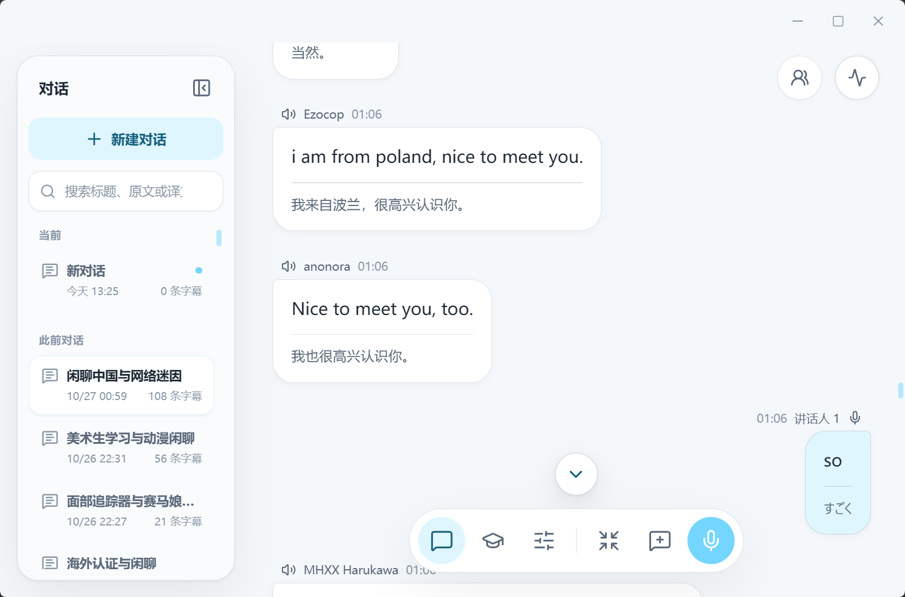

<p align="center">
    
</p>

<p align="center">
    VRCS 是面向 VRChat 的字幕、翻译、语言学习与 AI 工具。
</p>

<p align="center">
    
    
    
</p>

<p align="center">
    <a href="README.md">English</a> | <strong>简体中文</strong> | <a href="README.zh-Hant.md">繁體中文</a> | <a href="README.ja-JP.md">日本語</a>
</p>

<p align="center">
    <a href="https://github.com/Dreaminko/VRCS/releases/latest">下载</a> · <a href="https://github.com/Dreaminko/VRCS/issues">问题反馈</a> · <a href="CONTRIBUTING.md">参与贡献</a> · <a href="https://discord.gg/aCDnfX7paC">Discord</a> · <a href="https://qm.qq.com/q/i9kOOxFn44">QQ 群</a>
</p>



## 安装

- **Windows（`x64`）**：从 [GitHub Releases](https://github.com/Dreaminko/VRCS/releases) 下载 `VRCS-<version>-windows-x64.exe`。需要 Windows 10 / 11 与 [Microsoft Visual C++ v14 Redistributable（x64）](https://aka.ms/vs/17/release/vc_redist.x64.exe)。
- **Linux（`x86_64`）**：从 [GitHub Releases](https://github.com/Dreaminko/VRCS/releases) 下载 `.deb`、`.rpm` 或 `AppImage`，或通过 AUR 安装 [`vrcs-bin`](https://aur.archlinux.org/packages/vrcs-bin)（`yay -S vrcs-bin` / `paru -S vrcs-bin`）。依赖 PipeWire 与 Secret Service；启用 GPU 加速需系统已安装 Vulkan 加载器与显卡驱动。
- **软件更新**：Windows 与 AppImage 支持应用内更新，可在「设置 › 系统 › 软件更新」开启「接收 Nightly 更新」体验测试版。`.deb`、`.rpm` 与 AUR（`vrcs-bin`）请通过包管理器更新。

## 主要功能

- **双路实时字幕**：同时采集系统或 VRChat 进程音频与麦克风，生成双路实时字幕，支持独立音源控制、紧凑窗口和本地会话历史。
- **语音识别与断句**：支持本地 Qwen3 ASR（CPU 或 Vulkan），以及 Qwen3 ASR、Fun-ASR、OpenAI Realtime、Gemini、Groq、OpenRouter、Xiaomi MiMo 等云端服务，并结合 Silero VAD 与可选的 Smart Turn 语义断句进行分段。
- **多语言翻译**：每路音源最多可手动或自动翻译为三种语言，且每种语言可单独选择服务与模型。支持离线本地 PLaMo（CPU）翻译，以及 DeepL、Microsoft Translator、OpenAI、Gemini、阿里云、DeepSeek、Ollama、LM Studio 和各类 OpenAI 兼容服务。
- **实时音频直译**：接入 Qwen Live Translate、Gemini Live Translate 与 OpenAI Realtime Translation，直接同步输出实时原文与译文。
- **上下文与术语管理**：支持自定义提示词、本地与订阅术语表、房间及字幕上下文（可基于本地 VRChat 日志或网络采集生效），还可联动 [VRCX-0](https://vrcx-0.dev/) 获取当前世界与成员信息，并通过语言预设一键切换识别、翻译和 Chatbox 配置。
- **对话管理**：可为已结束的会话生成 AI 总结标题，并按标题检索历史记录。该功能默认关闭，可在「设置 › 系统 › 对话管理」与「设置 › API 与模型」配置模型与自动生成开关，也可在历史菜单中手动生成或重新生成；自定义命名始终优先。
- **VRChat OSC Chatbox 输出**：将麦克风字幕与译文发送至 VRChat Chatbox，支持快捷输入、翻译预览、多语言输出以及可选的 OSCQuery 静音同步。
- **VR 字幕叠层（SteamVR / OpenXR & OpenVR）**：在头显内或手腕面板查看多语言字幕，并通过 VR 仪表盘直接调整字幕布局、语言与 Chatbox 设置，支持 Windows 与 Linux（`x86_64`）。
- **OCR 翻译**：在桌面（Windows 与 Linux 经由 Screenshot Portal）或 VR（Windows）中框选文字进行识别与翻译，采用本地 PP-OCRv6（CPU，Windows 另支持 DirectML GPU），结果可显示于桌面窗口、手腕面板或 VR 中的原文位置。
- **视觉问答**：对桌面（Windows 与 Linux 经由 Screenshot Portal）或 VR（Windows）中框选的画面区域提问——桌面支持打字或语音输入，VR 中按住左扳机即可语音提问。回答显示在独立窗口或支持 Markdown 的手腕面板上，无需开启 OCR。*（由于上游 OpenXR / Monado 场景捕获接口尚不完善，VR OCR 与 VR 视觉问答目前仅支持 Windows。）*
- **语言学习与 Anki**：支持导入 Yomitan 词典，在字幕中直接查词或「问 AI」，进行词义解释、句型分析与会话回顾；还可编辑词汇、句型或完形填空卡片，通过 AnkiConnect 发送至 Anki。

### 实验性 VRChat 网络采集

- **VRChat 分玩家独立音轨（实验性）**：在「设置 › 采集」启用后，可为不同玩家分别识别与翻译、筛选处理对象（支持「优先处理视野内玩家（实验性）」），并在桌面与 VR 字幕中显示说话人。
- **接收并翻译 VRChat Chatbox（实验性）**：可在「设置 › 采集」开启「接收并翻译 VRChat Chatbox」（默认关闭）。实际接收跟随全局开始／停止采集开关，将其他音源和麦克风均设为关闭即可进入纯文字接收模式，无需启动 ASR 或 VAD。自动翻译使用「将对方的语言翻译为」中配置的文字翻译服务（实时音频翻译不能替代文字翻译），接收到的消息不会通过 OSC 回传到 VRChat。
- **使用前提**：以上两项功能共用实验性的「VRChat 网络采集」后端。
  - **Windows**：需要以管理员权限运行 VRCS、选择实际分页文件所在磁盘并关闭系统内存压缩（修改后需重启电脑生效）。
  - **Linux（`x86_64`）**：需要通过系统安装包（`.deb`、`.rpm` 或 AUR `vrcs-bin`，会安装 `/usr/bin/vrcs-desktop` 与对应的 polkit 策略），确保图形会话中运行着 polkit 认证代理，并安装系统 Opus 库（`libopus0` / `opus`）用于分玩家音频解码。AppImage 不包含系统二进制与策略文件，请改用系统包或参考 [CONTRIBUTING.md](CONTRIBUTING.md#linux-development-initial-adaptation) 手动配置。
  - 开启前请仔细阅读应用内的服务条款、隐私及账号风险提示。

## 隐私

VRCS 不保存原始音频，字幕历史、学习项目、词典和设置默认保存在本机。本地 Qwen ASR、本地 PLaMo 翻译与本地 OCR 均在设备上完成语音、文本和图像处理；云端语音识别会将语音片段发送给所选服务商。

云端翻译、学习分析和「问 AI」会将相关文本、明确选择的上下文及提交的问题发送给对应服务。本地识别后的文本是否会上传云端，取决于你选择的翻译和 AI 服务（若翻译选用本地 PLaMo，则文本同样保留在本机）。

对话标题生成会将当前会话的部分或全部字幕原文发送给所选模型服务（可能产生费用），不发送译文、原始音频或其他会话；长会话会自动采样，也不会自动对旧历史批量生成标题。

桌面 OCR 与视觉问答仅处理你框选的区域。视觉问答会将选区图片和问题文本发送给所选模型服务；若问题通过云端语音识别输入，对应的语音也会发送给语音识别服务。图片和问答默认不会写入磁盘或问答历史，语音识别与图像请求可能分别计费。

## 开发

开发环境需要 Windows 10 / 11（或 Linux `x86_64`）、Node.js 24+、Rustup（版本与组件见 `rust-toolchain.toml`）、已加入 `PATH` 的 CMake，以及 Windows 下的 Visual Studio Build Tools（「使用 C++ 的桌面开发」工作负载）。

在仓库根目录的 PowerShell（Windows）中运行：

```powershell
npm install
npm run dev
```

默认构建使用 CPU 运行本地 Qwen ASR；如需 Vulkan 加速，可使用 `npm run dev:vulkan`，命令会自动准备加载器，无需安装 GPU SDK 或着色器编译器。本地运行组件与模型可在「设置 › API 与模型 › 本地模型」中下载。独立后端开发见 [Core README](core/README.md)。

在 Linux（`x86_64`）上开发时，可先运行 `bash scripts/install-linux-deps.sh` 安装系统依赖，再执行 `npm ci` 与 `npm run dev`（或 `npm run dev:vulkan`）。完整的 Linux 构建条件及网络采集开发配置说明见 [CONTRIBUTING.md](CONTRIBUTING.md#linux-development-initial-adaptation)。

按改动范围运行检查：

```powershell
npm run check:i18n
npm --workspace apps/desktop test
npm run build:frontend
.\scripts\check-rust.ps1
```

Rust 脚本会对工作区所有 crate 执行格式检查、Clippy 和测试；涉及 Vulkan 改动时请附加 `-Vulkan`。

构建同时支持 CPU 与 Vulkan 的 Windows 安装包：

```powershell
npm run build
```

贡献规范见 [CONTRIBUTING.md](CONTRIBUTING.md)，界面翻译指南见 [LOCALIZATION.md](LOCALIZATION.md)。

## 许可证

[GNU Affero General Public License v3.0](LICENSE)（`AGPL-3.0-only`）。第三方许可见 [THIRD_PARTY_NOTICES.md](THIRD_PARTY_NOTICES.md)。
