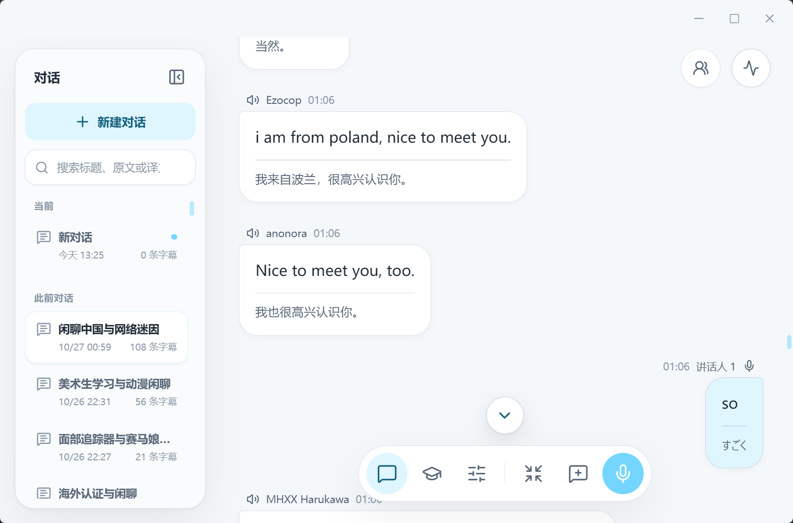

<p align="center">
    
</p>

<p align="center">
    VRCS 是面向 VRChat 的字幕、翻譯、語言學習與 AI 工具。
</p>

<p align="center">
    
    
    
</p>

<p align="center">
    <a href="README.md">English</a> | <a href="README.zh-CN.md">简体中文</a> | <strong>繁體中文</strong> | <a href="README.ja-JP.md">日本語</a>
</p>

<p align="center">
    <a href="https://github.com/Dreaminko/VRCS/releases/latest">下載</a> · <a href="https://github.com/Dreaminko/VRCS/issues">回報問題</a> · <a href="CONTRIBUTING.md">參與貢獻</a> · <a href="https://discord.gg/aCDnfX7paC">Discord</a> · <a href="https://qm.qq.com/q/i9kOOxFn44">QQ 群組</a>
</p>



## 安裝

- **Windows（`x64`）**：從 [GitHub Releases](https://github.com/Dreaminko/VRCS/releases) 下載 `VRCS-<version>-windows-x64.exe`。需要 Windows 10 / 11 與 [Microsoft Visual C++ v14 Redistributable（x64）](https://aka.ms/vs/17/release/vc_redist.x64.exe)。
- **Linux（`x86_64`）**：從 [GitHub Releases](https://github.com/Dreaminko/VRCS/releases) 下載 `.deb`、`.rpm` 或 `AppImage`，或透過 AUR 安裝 [`vrcs-bin`](https://aur.archlinux.org/packages/vrcs-bin)（`yay -S vrcs-bin` / `paru -S vrcs-bin`）。相依於 PipeWire 與 Secret Service；啟用 GPU 加速需系統已安裝 Vulkan 載入器與顯示卡驅動程式。
- **軟體更新**：Windows 與 AppImage 支援應用程式內更新，可在「設定 › 系統 › 軟體更新」開啟「接收 Nightly 更新」試用測試版。`.deb`、`.rpm` 與 AUR（`vrcs-bin`）請透過套件管理員更新。

## 主要功能

- **雙串流即時字幕**：同時擷取系統或 VRChat 程序音訊與麥克風，產生雙路即時字幕，支援獨立音源控制、精簡視窗與本機工作階段記錄。
- **語音辨識與斷句**：支援本機 Qwen3 ASR（CPU 或 Vulkan），以及 Qwen3 ASR、Fun-ASR、OpenAI Realtime、Gemini、Groq、OpenRouter、Xiaomi MiMo 等雲端服務，並結合 Silero VAD 與可選的 Smart Turn 語意斷句進行分段。
- **彈性多語翻譯**：每路音源最多可手動或自動翻譯為三種語言，並可分別選擇服務與模型。支援離線本機 PLaMo（CPU）翻譯，以及 DeepL、Microsoft Translator、OpenAI、Gemini、阿里雲、DeepSeek、Ollama、LM Studio 與相容 OpenAI 的服務。
- **即時音訊直譯**：透過 Qwen Live Translate、Gemini Live Translate 與 OpenAI Realtime Translation，直接同步產生即時原文與譯文。
- **上下文與術語管理**：支援自訂提示詞、本機與訂閱術語表、房間及字幕上下文（可透過本機 VRChat 日誌或網路擷取取得），並可串接 [VRCX-0](https://vrcx-0.dev/) 的世界與成員資訊，透過語言預設一次切換辨識、翻譯與 Chatbox 設定。
- **對話管理**：可為已結束的對話產生 AI 摘要標題，並依標題搜尋歷史記錄。此功能預設關閉，可在「設定 › 系統 › 對話管理」與「設定 › API 與模型」設定模型與自動產生，或從歷史對話選單手動產生與重新產生；自訂名稱始終優先。
- **VRChat OSC Chatbox 輸出**：將麥克風字幕與譯文傳送至 VRChat Chatbox，支援快速輸入、翻譯預覽、多語言輸出及可選的 OSCQuery 靜音同步。
- **VR 字幕疊層（SteamVR / OpenXR & OpenVR）**：在頭戴裝置內或手腕面板閱讀多語言字幕，並透過 VR 儀表板直接調整字幕版面、目標語言與 Chatbox 設定，支援 Windows 與 Linux（`x86_64`）。
- **OCR 翻譯**：在桌面（Windows 與 Linux 經由 Screenshot Portal）或 VR（Windows）中框選文字進行辨識與翻譯，採用本機 PP-OCRv6（CPU，Windows 另支援 DirectML GPU），結果可顯示於桌面視窗、手腕面板或 VR 中的原文位置。
- **視覺問答**：針對桌面（Windows 與 Linux 經由 Screenshot Portal）或 VR（Windows）中框選的區域畫面提問——桌面支援鍵入或語音輸入，VR 中按住左扳機即可語音提問。回答會顯示在獨立視窗或支援 Markdown 的手腕面板上，無須啟用 OCR。*（因上游 OpenXR / Monado 場景擷取介面尚未完備，VR OCR 與 VR 視覺問答目前僅支援 Windows。）*
- **語言學習與 Anki**：匯入 Yomitan 字典後，可在字幕中直接查詞或「問 AI」，進行詞義解釋、句型分析與對話回顧；還可編輯詞彙、句型或克漏字卡片，透過 AnkiConnect 傳送至 Anki。

### 實驗性 VRChat 網路擷取

- **VRChat 分玩家獨立音軌（實驗性）**：在「設定 › 擷取」啟用後，可分別辨識與翻譯每位玩家的語音、篩選處理對象（支援「優先處理視野內玩家（實驗性）」），並在桌面與 VR 字幕中顯示發話者名稱。
- **接收並翻譯 VRChat Chatbox（實驗性）**：可在「設定 › 擷取」開啟「接收並翻譯 VRChat Chatbox」（預設關閉）。實際接收會跟隨全域開始／停止擷取開關，若將其他音源與麥克風設為停用即可純接收文字，無須啟動 ASR 或 VAD。自動翻譯使用「將對方的語言翻譯為」中所設定的文字翻譯服務（即時音訊翻譯無法取代文字翻譯），接收到的訊息不會透過 OSC 回傳至 VRChat。
- **使用條件**：上述兩項功能共用實驗性的「VRChat 網路擷取」後端。
  - **Windows**：須以系統管理員身分執行 VRCS、選擇實際分頁檔案所在磁碟機，並關閉 Windows 記憶體壓縮（變更後須重新啟動電腦）。
  - **Linux（`x86_64`）**：須透過系統套件安裝（`.deb`、`.rpm` 或 AUR `vrcs-bin`，會提供 `/usr/bin/vrcs-desktop` 與對應的 polkit 策略），確保圖形工作階段中正執行 polkit 認證代理，並安裝系統 Opus 函式庫（`libopus0` / `opus`）以供分玩家音訊解碼。AppImage 不包含系統二進位檔與策略檔案，請改用系統套件或參考 [CONTRIBUTING.md](CONTRIBUTING.md#linux-development-initial-adaptation) 手動設定。
  - 啟用前請先閱讀應用程式內的服務條款、隱私與帳號風險說明。

## 隱私

VRCS 不會儲存原始音訊，字幕記錄、學習項目、字典與設定預設皆儲存在本機。本機 Qwen ASR、本機 PLaMo 翻譯與本機 OCR 均於裝置端處理語音、文字與影像；雲端語音辨識則會將語音片段傳送給所選供應商。

雲端翻譯、學習分析與「問 AI」會將相關文字、明確選取的上下文及提交的問題傳送至設定的服務。本機辨識後的文字是否上傳雲端，取決於你選用的翻譯與 AI 服務（若翻譯採用本機 PLaMo，文字同樣保留於本機）。

對話標題產生會將該對話的部分或全部字幕原文傳送至所選模型服務（可能產生費用），不會傳送譯文、原始音訊或其他對話；長對話會進行取樣，也不會自動批次為舊歷史補全標題。

桌面 OCR 與視覺問答僅處理所框選的區域。視覺問答會將選區圖片與問題文字傳送至設定的模型服務；若以雲端語音辨識提問，語音也會傳送至語音辨識服務。圖片與問答預設不會儲存至磁碟或問答記錄，語音辨識與圖像請求可能分別計費。

## 開發

開發環境需要 Windows 10 / 11（或 Linux `x86_64`）、Node.js 24+、Rustup（版本與元件見 `rust-toolchain.toml`）、已加入 `PATH` 的 CMake，以及 Windows 下的 Visual Studio Build Tools（「使用 C++ 的桌面開發」工作負載）。

在儲存庫根目錄的 PowerShell（Windows）中執行：

```powershell
npm install
npm run dev
```

預設建置以 CPU 執行本機 Qwen ASR；如需 Vulkan 加速可使用 `npm run dev:vulkan`，命令會自動準備載入器，不需安裝 GPU SDK 或著色器編譯器。本機執行元件與模型可於「設定 › API 與模型 › 本機模型」下載。獨立後端開發請見 [Core README](core/README.md)。

在 Linux（`x86_64`）上開發時，可先執行 `bash scripts/install-linux-deps.sh` 安裝系統相依套件，再執行 `npm ci` 與 `npm run dev`（或 `npm run dev:vulkan`）。完整的 Linux 建置條件及網路擷取開發說明請見 [CONTRIBUTING.md](CONTRIBUTING.md#linux-development-initial-adaptation)。

依變更範圍執行檢查：

```powershell
npm run check:i18n
npm --workspace apps/desktop test
npm run build:frontend
.\scripts\check-rust.ps1
```

Rust 指令碼會對工作區所有 crate 執行格式檢查、Clippy 與測試；涉及 Vulkan 變更時請加上 `-Vulkan`。

建置同時支援 CPU 與 Vulkan 的 Windows 安裝程式：

```powershell
npm run build
```

貢獻指南見 [CONTRIBUTING.md](CONTRIBUTING.md)，介面翻譯指南見 [LOCALIZATION.md](LOCALIZATION.md)。

## 授權

[GNU Affero General Public License v3.0](LICENSE)（`AGPL-3.0-only`）。第三方授權見 [THIRD_PARTY_NOTICES.md](THIRD_PARTY_NOTICES.md)。
