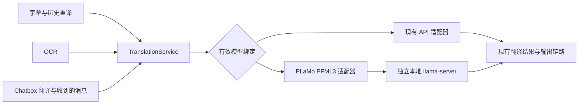

# PLaMo 3 Translate 本地翻译支持计划书

日期：2026-11-07。状态：Windows x64 CPU 首版已实施，真实模型冒烟通过；质量、性能及安装包验收待完成。

## 1. 建议与实施目标

建议将 **PLaMo 3 Translate 0.8B 的官方 GGUF Q4_K_M 版本**接入为 VRCS 的专用本地翻译后端，由应用管理模型文件并启动独立的 `llama-server` 进程。首个交付版本以 Windows x64、CPU 推理为必达目标；Vulkan 作为后续可独立交付的加速项。

接入现有翻译服务，覆盖麦克风／对方字幕的自动与手动翻译、历史重新翻译、OCR、Chatbox 翻译预览及收到的 VRChat Chatbox 消息。用户可以按任务和目标语言混用本地模型与现有 API 服务，不改变已有配置的默认选择。

本次实现只新增文字翻译能力。语音识别、视觉理解、对话标题和学习解释继续使用各自现有模型；没有引入 Python、PyTorch、vLLM 或新的 npm／Cargo 依赖。改动覆盖配置、推理进程、翻译入口、设置界面、下载校验及共享运行时资源。

## 2. 模型依据与适用边界

用户指定的[基础模型](https://huggingface.co/pfnet/plamo-3-translate-0.8b)是翻译专用模型，官方列出 53 种语言，区分简体与繁体中文，并支持上下文和术语表。训练时输入与输出的合计上限为 32,768 tokens；这不等于 VRCS 应默认分配同样大的运行上下文。

首版使用官方发布的[GGUF 版本及其调用协议](https://huggingface.co/pfnet/plamo-3-translate-0.8b-GGUF)，无需自行转换权重。下载清单固定如下，不能使用浮动 `main`：

| 项目 | 固定值 |
| --- | --- |
| 仓库 | `pfnet/plamo-3-translate-0.8b-GGUF` |
| revision | `dbeb0856cb0b004b484f190bb71dd65876297013` |
| 文件 | `plamo-3-translate-0.8b-Q4_K_M.gguf` |
| 文件大小 | `573123200` bytes，约 573 MB／547 MiB |
| 预期 SHA-256 | `923b2f28a9856de1b8b3b610a7e59ded0b14d007466fd5dd526e6a9ecaadafdd` |
| 许可证副本 | 同一 revision 的 `LICENSE/en` |
| VRCS 模型标识 | `plamo-3-translate-0.8b-q4_k_m` |

模型、许可证和 Windows x64 CPU 运行时均已下载并计算摘要，数值与固定清单一致。b11501 已真实加载 GGUF，完成英→日、日→英、简→繁翻译，并验证上下文与术语表对结果的约束；停止后可在同一运行时重新启动并继续翻译。人工质量集、延迟 P95 和安装包验收仍需完成。

语言处理必须采用模型自己的能力表，而不是沿用通用 LLM 的任意目标语言选项：

- `zh-Hans`、`zh-Hant` 分别映射为 `zh-hans`、`zh-hant`；英文、日文、韩文使用 `en`、`ja`、`ko`。不把未指定字形的 `zh` 目标静默解释为简体中文。
- 官方列表未包含粤语、葡萄牙语、捷克语等项目现有选项。本地目标语言选择器只提供官方支持项，后端也拒绝不支持的目标，不能依靠模型猜测。
- 不把 `fil` 无提示地映射为官方列出的 `tl`。本地列表使用 Tagalog／`tl`；其他别名只做大小写规范化，不自行推断地区或语言等价关系。
- 源语言未知、为 `auto`、仅为笼统的 `zh` 或不在支持表时，省略源语言属性，让模型自动判断。目标语言始终显式指定。

官方评测不能证明 VRChat 短句、玩家名字、口语或 OCR 噪声的表现。首轮质量验收聚焦中、英、日、韩及简繁转换；其余官方支持语言可以提供选择，但不宣传未经验证的质量水平。

## 3. 仓库现状与接入位置

| 代码位置 | 当前行为 | 本次处理 |
| --- | --- | --- |
| `core/src/translation/mod.rs` | `TranslationService` 统一调用翻译 API 或通用 LLM；需要 `profile_id` | 在读取 API Profile 和凭据前分派本地后端，复用结果、错误与进度接口 |
| `core/src/translation/dispatcher.rs` | 自动翻译有 64 项队列、4 个全局并发许可和任务有效性检查 | 保留现有字幕生命周期，本地后端增加自己的推理并发限制 |
| `core/src/translation/prompt.rs` | 构造通用 LLM instructions 和输入；上下文是原文条目 | 为 PLaMo 单独构造 PFML3，不复用通用 system prompt，也不把原文上下文伪装成已翻译历史 |
| `core/src/config/model_assignment.rs` | 默认模型、任务模型及语言路由逐级继承 Profile／model | 继承时同时复制后端类型，覆盖 OCR 和语言预设 |
| `core/src/config/validation.rs` | 根据 API Profile 校验翻译配置；实时 ASR 的第一目标有独立处理 | 新增本地分支与语言能力校验，保留实时 ASR 现有优先级 |
| `core/src/ocr/tasks.rs` | 多处用 `profile_id.is_some()` 判断是否翻译；缓存包含目标配置 | 改成判断有效翻译绑定，并把固定模型 revision 纳入本地缓存身份 |
| `core/src/asr/qwen_runtime.rs`、`qwen_runtime_download.rs` | 已有固定版本的 llama.cpp、回环鉴权、CPU／Vulkan、启动与退出管理 | 复用运行时资源与底层机制，翻译进程独立持有生命周期 |
| `core/src/asr/qwen_models/` | 已有分阶段下载、校验、安装状态与目录迁移机制 | 复用下载与安装原语，增加独立的翻译模型包清单 |
| `apps/desktop/src/settings/model-selection.ts`、`api/ModelSelectionField.tsx`、`sections/ModelAssignmentsSection.tsx` | 选择和继承围绕 API Profile 实现 | 仅在翻译能力选择器中加入“本地 PLaMo” |

配置 schema 已由 **38** 升级到 **39**，沿用现有迁移链保护用户原有配置；旧配置中缺失的 `backend` 一律按 `api` 读取。

## 4. 技术路线与取舍

| 路线 | 工作量与用户成本 | 决策 |
| --- | --- | --- |
| 专用 PLaMo 适配器连接用户自行启动的本机服务 | 最小实现；仍需要用户安装运行时、下载模型、启动进程并填写地址 | 作为最小替代方案，不作为默认产品体验 |
| 应用托管 GGUF＋独立 `llama-server` | 复用已有 Windows 分发方式；用户在应用内下载并选择模型 | **推荐**，完整解决本地模型的使用与维护 |
| Transformers／vLLM 服务 | 新增 Python／GPU 部署环境，增加每位用户的安装成本 | 首版不采用 |
| 将推理库嵌入 Core 进程 | 新增 FFI／构建耦合，模型故障直接影响主进程 | 首版不采用 |

方案沿用项目固定的 **llama.cpp b11501**。其[架构注册代码](https://github.com/ggml-org/llama.cpp/blob/b11501/src/llama-arch.cpp)已有 `plamo3` 条目，服务也提供所需的[Completions 和运行参数](https://github.com/ggml-org/llama.cpp/blob/b11501/tools/server/README.md)。真实模型已通过 b11501 的加载、流式输出、停止与重启冒烟检查，因此本次没有升级共用运行时，也没有改变现有 QwenASR 的运行时版本。



独立进程复用同一份运行时二进制资源，但不复用 ASR 的端口、请求槽位、进程句柄或停机操作；两份模型仍会竞争整机 CPU／GPU 资源，必须通过同时运行的验收检查。

## 5. 配置与模型选择契约

新增 `backend`，枚举为 `api` 和 `plamo_local`，缺省为 `api`。将该字段加入 `ModelBinding`、`ModelSelection` 和 `TranslationTargetConfig`，继续使用现有 `model` 字段标识模型，不引入第二套模型分配系统。缺省 API 值可以省略序列化，减少现有配置变化。

本地任务绑定的完整含义是：

| 字段 | 值／规则 |
| --- | --- |
| `backend` | `plamo_local` |
| `profile_id` | `null`，不创建伪 API Profile |
| `model` | `plamo-3-translate-0.8b-q4_k_m` |
| `use_default_model` | 任务独立选择时为 `false`；目标语言跟随任务时为 `true` |
| `thinking_enabled`／`reasoning_control` | 本地有效绑定强制关闭／清空 |

新增应用级 `local_translation.device`，首版缺省 `cpu`。模型目录沿用 `storage.model_directory`，模型存放在其 `translation/plamo-3-translate-0.8b-q4_k_m/` 子目录；不新增路径、端口、URL、线程数或环境变量设置。

配置规则：

1. 翻译任务和 OCR 任务可独立选择本地后端；各目标语言仍能覆盖任务选择。继承必须复制 `backend/profile_id/model` 的完整组合，包含语言预设和前端乐观更新。
2. 全局文字／视觉默认、标题、学习和视觉提问不接受 `plamo_local`。这是翻译专用能力，不能因为共用绑定结构就进入通用生成模型选项。
3. 切换本地与 API 时保留现有 `model_by_profile` 记忆；本地模型不写入任何 Profile 的记忆项。后端变化也属于清除旧 reasoning 设置的条件。
4. 当前配置升级到 schema **39**；旧配置所有遗漏的 `backend` 取 `api`，旧模型选择和开关保持原值。迁移前保留原始配置备份；不在迁移时下载、加载或启用模型。若实施前 schema 已前移，使用届时下一个版本号。
5. 所有调用入口通过同一绑定判定判断“已配置”，不能继续单独检查 `profile_id`。未安装是运行状态，不等于绑定缺失；错误应引导用户下载。
6. 自动模式下，ASR 自带实时翻译的第一目标继续走现有链路。该位置显示真实生效来源并禁用无效的本地选择；要让第一目标经过 PLaMo，需要选择不自带翻译的 ASR，或使用现有手动文字翻译路径。其他文字翻译目标可照常选择本地。

## 6. 推理、上下文与运行资源

### 6.1 请求协议

新增 `core/src/translation/plamo.rs`，实现专用 PFML3 构造和 `/v1/completions` 客户端。协议遵循官方 GGUF 说明：固定 `dataset=translation`，显式提供目标语言，以空 `output` 正文开始生成；上下文和术语表放入各自的 PFML3 元素。

使用确定性解码 `temperature=0`，停止标记为 `<|plamo:tag|>` 和 `<|plamo:bos|>`。BOS 交给运行时按模型元数据添加，不手工重复添加。流式请求解析 `choices[].text`，汇总为现有完整文本进度回调；同时支持非流式诊断请求。

具体约束：

- 直接读取术语表的结构化 source／target 项，不解析通用 LLM 已格式化的术语表字符串；只发送具有有效译法的项，不能把空的可选 `target` 当作译法。
- 沿用 `context_enabled`、来源过滤、`max_messages`、`max_chars`，再施加本地 token 预算。现有上下文只含原文，因此放入 `context`，首版不增加原文／译文对历史查询。
- 任意自定义 `system_prompt` 不作为 PLaMo 指令。设置页解释这一能力差异；API 模型继续保留原提示词设置。本地提示词预览展示实际 PFML3，而非通用 LLM 预览。
- 当前正文、上下文或术语项若包含 PFML3 保留控制标记，返回明确的格式不支持错误，不能直接拼接为结构标记，也不能静默修改用户原文。
- 保留同语言直接返回的既有规则，但简体与繁体互译必须经过正确的字形区分。结果清理只移除协议终止标记，不使用可能删掉正常译文的宽泛正则。
- 空结果、异常结束、SSE 中断和 `finish_reason=length` 都不记作成功；不把不完整译文写入最终历史或发送到 OSC。

### 6.2 进程与并发

在 `core/src/translation/plamo_runtime.rs` 新增 `PlamoRuntime`，由 Core 启动组装并注入 `TranslationService`。首次本地翻译请求触发加载；并发首次请求由同一启动锁合并，多个调用者不能重复启动进程。目录迁移和下载会等待进行中的本地翻译结束并停止对应子进程；卸载会直接停止运行时。暂停语音采集不停止仍可能供 OCR／Chatbox 使用的翻译模型。

首版运行参数固定为：两个推理槽位；总上下文 `8192` tokens，即每槽 `4096`；每请求最多生成 `1024` tokens；CPU 线程数取 `max(1, min(4, logical_cpu_count / 2))`。本地并发限制设在适配器边界，覆盖 OCR、手动请求与自动队列，最多 2 个活动请求；额外等待项最多 8 个，超限立即返回队列繁忙错误，不新增无限队列。不能先持有多个本地许可再等待其余目标，避免 3 目标翻译与 2 槽位相互等待。

调用同一本地服务的 `/tokenize` 按真实 token 数计算预算，不新增 tokenizer 依赖；计数包含结构标记和模型需要的 BOS。优先裁掉最旧上下文，再减少术语表；保留完整当前正文及输出空间。当前正文无法放入预算时返回长度错误，首版不自动拆段，也不静默截断。接口原有 5,000 字符限制继续存在，本地 token 上限可能更早触发。

加载超时初值 60 秒；加载完成后的单次调用总时限为 8 秒，包含等待推理许可的时间。沿用现有调用方取消及有效性检查，并将模型 generation 与配置绑定纳入结果有效性检查，防止切换后回写旧结果。本地错误不进入自动云端回退；模型缺失、队列繁忙、超时和进程退出分别提供可操作的错误。

进程仅监听随机回环端口并使用临时 Bearer token；本地 HTTP 禁用代理与重定向。日志记录状态、耗时和错误类别，不记录正文、术语或 token。安装后的本地翻译请求不访问模型下载站或云端 API；其他已启用的应用服务仍遵循各自设置。

## 7. 下载、界面与许可证

### 7.1 模型安装与管理

复用现有分阶段下载、SHA-256 校验和安装原语，仅提取两种模型确实共用的运行时资源与文件操作，不借机重构整个 ASR 模型管理系统。模型与许可证均从固定 revision 获取；下载阶段使用临时目录，验证完成后才激活。取消、损坏及失败的下载不影响已安装模型。公开模型下载不要求 Hugging Face token 或翻译 API Key；首版不新增第三方账号配置，商业登记单独按实际用途处理。

共享运行时包沿用现有固定版本与摘要。已随应用打包或安装时直接复用，无需用户为了翻译另行安装 ASR 权重；缺失时由本地翻译安装任务补齐运行时资源。共用运行时仍被 ASR 使用时不得删除。

新增以下 Core API，状态字段沿用现有下载任务风格：

| 接口 | 用途 |
| --- | --- |
| `GET /api/local-translation` | 模型清单、支持语言、下载／校验／运行状态与错误 |
| `POST /api/local-translation/download` | 请求体提供固定模型 `id`，安装所需运行时及模型 |
| `POST /api/local-translation/cancel` | 取消当前安装任务 |
| `POST /api/local-translation/verify` | 校验当前模型包 |
| `POST /api/local-translation/unload` | 停止运行时并释放翻译模型资源 |
| `DELETE /api/local-translation/models/{id}` | 等待进行中的本地翻译结束，停止运行时后显式删除模型 |

模型目录迁移纳入现有设置变更流程：先停止翻译进程及相关下载，再迁移；成功后更新目录，失败时恢复旧目录引用。卸载模型不删除翻译历史、不改 API Profile，也不自动选择其他服务。

### 7.2 用户界面

在“模型分配”的翻译及 OCR 任务／目标语言选择器中加入“本地 PLaMo”，并在翻译设置加入 `LocalTranslationPanel.tsx`，提供下载、取消、校验、卸载、运行状态和释放资源操作。未安装时仍能保存选择，但必须显示安装入口；首版默认不下载、不启用本地翻译。

界面显示约 573 MB 的模型下载量、运行时是否已具备、实际生效后端、语言限制及提示词能力差异。历史中的本地结果保留 `provider=plamo_local` 和固定模型标识，不套用云模型价格或查询云端模型能力。OCR 缓存身份包含后端、模型 revision、提示格式版本、上下文与术语表，避免模型包更新后复用旧结果。

现有 `/api/translations/prompt-preview` 增加可选 `backend`，缺省 `api`；本地预览使用同一 PFML3 构造函数。必要的文案同步英语、简体中文、繁体中文和日语。

### 7.3 许可证与输出标识

权重使用 **PLaMo Community License**，不能按 VRCS 的 AGPL-3.0 或 Apache/MIT 权重处理。依据[固定版本许可证](https://huggingface.co/pfnet/plamo-3-translate-0.8b-GGUF/blob/dbeb0856cb0b004b484f190bb71dd65876297013/LICENSE/en)：商业使用涉及预先登记和年收入门槛；再分发需要附带协议及 `Built with PLaMo` 标识；公开输出还涉及模型来源标注。商业使用条件应以维护者实际用途核对。

对应交付要求：

- 模型按需单独下载，不混入源码许可证；保留官方协议副本，在模型详情展示 `Built with PLaMo` 和许可链接，并更新 `THIRD_PARTY_NOTICES.md`。下载前提供一次协议接受入口，记录所接受的模型 revision。
- 公共输出不能仅依赖设置页署名。PLaMo 生成的 OSC／Chatbox 发送文本和纯文本导出保留 ` [PLaMo]` 来源标记；标记参与现有长度预算，截断不得移除标记。界面内历史使用已有 provider／model 元数据标识来源。
- Chatbox 的 `ChatboxComposeInput` 增加可选 `translation_origin: { provider: string, model: string }`，预览和发送均消费同一来源。它来自生成结果，不能根据发送时的全局设置猜测；手写内容不自动冒充模型输出。本地预览仍需用户执行发送操作。发送后的现有 `rendered_text` 保留标记，重新发送不能丢失或重复附加标记；不为此增加数据库列。
- 发布负责人在分发前核对商业登记、输出标识与现有 OSC 模板的处理是否满足协议；不通过这一门槛就不发布 PLaMo 模型功能。

## 8. 工作包、交付顺序与投入

以下工作包按依赖顺序执行。首版 CPU 功能作为一个完整版本交付，不能只合并隐藏的配置和界面就宣称已支持本地翻译；后续加速项独立可用。

| 工作包 | 主要文件／动作 | 完成条件 | 状态 | 单人预估 |
| --- | --- | --- | --- | --- |
| A. 固定资源与运行接入 | 新增翻译模型 manifest、`PlamoRuntime`；接入 `startup/assembly.rs`、`server/runtime.rs`；复用 b11501 资源 | 真实 GGUF 在 CPU 上加载，完成中英日短句及停止标记检查；失败则不启用本地入口 | 已完成 | 1–2 天 |
| B. 配置和继承 | `config/model_assignment.rs`、`translation.rs`、`schema.rs`、`migration.rs`、`validation.rs`；前端 `settings/types.ts`、`model-selection.ts` | API 配置迁移不变，本地任务／路由／预设继承正确，非翻译任务拒绝本地绑定 | 已完成 | 1–1.5 天 |
| C. 适配与所有入口 | 新增 `translation/plamo.rs`；修改 `translation/mod.rs`、`ocr/tasks.rs`、预览接口及输出来源传递 | 自动／手动字幕、OCR、Chatbox 和历史重译均能无 API Profile 调用本地模型 | 已完成 | 1.5–2 天 |
| D. 下载与设置 | 新增本地翻译 API、`LocalTranslationPanel.tsx`；扩展 `ModelSelectionField.tsx`、`ModelAssignmentsSection.tsx`、前端绑定校验和四种语言文案 | 应用内完成安装、选择、状态查看及释放资源；迁移和取消可恢复 | 已完成 | 1.5–2 天 |
| E. 打包与验收 | 共享运行时资源、第三方声明、针对性测试和实机记录 | CPU 安装包离线翻译、双路 ASR 并行、错误恢复和输出署名通过 | 部分完成；安装包与双路并行待验收 | 1.5–2.5 天 |

CPU 完整版本合计约 **7–10 个工作日**，前提是固定运行时直接兼容模型，不含许可证外部沟通等待。若需要修复推理引擎兼容问题，重新评估范围，不把它隐藏在上述估算中。

后续 Vulkan 加速预计另需 1–3 个工作日，复用现有设备枚举与 feature gate；只有模型正确性、显存使用和 VR 帧时间验收通过，才将相应 GPU 模式作为正式选项。CPU 版本可独立保留和发布。

## 9. 验证与发布门槛

### 9.1 自动化验证

围绕实际行为增加测试，不测试文件形状或仅重复常量：

- 配置：旧版迁移、序列化往返、缺省 API、混合路由、预设继承、后端切换清除 reasoning、删除 Profile 不误伤本地绑定。
- 协议：中文语言代码、未知源语言、上下文／术语顺序、特殊字符、保留控制标记、BOS 不重复、停止标记、SSE 分块、空输出与生成截断。
- 集成：无 Profile 的本地 OCR 不被过滤；同一内容切换本地模型 revision 不命中旧缓存；三个目标在两个推理槽下均能完成；取消、超时、队列满及进程退出有明确结果。
- 生命周期：多个首次请求只启动一个进程；切换配置、目录迁移和应用退出不会回写旧译文，也不会停止 ASR 进程。
- 来源：本地结果贯穿预览、历史、OSC 和导出；输出长度预算包含来源标记；API 和手写输出不被误标。

实施完成后的基线命令：

```powershell
cargo test --manifest-path core/Cargo.toml
cargo test --manifest-path core/Cargo.toml real_plamo_translates_and_restarts_on_cpu -- --ignored --nocapture
npm --workspace apps/desktop test
npm run check:i18n
npm --workspace apps/desktop run build
```

2026-11-07 的执行结果：Rust 全量测试 `1023 passed, 35 ignored`，真实 PLaMo CPU 冒烟 `1 passed`，桌面端 `449 passed`，四语言 i18n 校验通过，Vite 生产构建通过。发布前仍需按现有 `npm run build` 流程生成并验收 Windows 安装包；命令通过不能替代真实模型和安装包验证。

### 9.2 实机与质量验收

准备 240 条可复用样例：中英、中日、英日、中韩、英韩、简繁转换六组，每组 40 条且两个方向均衡。样例包含口语、名字、数字、Emoji、换行、术语和 OCR 噪声，使用已批准的预期语义人工评分。

目标：至少 95% 结果可直接用于理解对话；至少 98% 的指定数字／名字得到保留或批准的术语转换；没有漏译否定、反转说话意图等严重错误。记录失败样例，不以另一模型的单一分数代替人工检查。

性能数值是准入目标，尚非实测承诺。基准使用 Windows x64、6–8 核 CPU、至少 16 GB 内存，记录具体 CPU、线程数、运行时和模型 revision：

| 场景 | 首版目标 |
| --- | --- |
| 已加载模型，单目标短句：约 15–40 个中日韩字符或 10–25 个英文单词 | 服务收到请求至完整结果的 P95 ≤ 2 秒，包含排队时间 |
| 三目标翻译、OCR 与字幕交错 | 无死锁、无无限积压；8 秒时限内给出结果或明确失败 |
| 与本地 QwenASR 麦克风／对方双路同时运行至少 10 分钟 | 无采集溢出；ASR 最终结果延迟 P95 相比相同负载基线增长 ≤ 20% |
| 翻译子进程资源 | 单独记录冷启动、峰值 RAM、CPU；CPU 首版 RAM 预算 ≤ 2 GiB |
| 网络断开，已安装模型，本地 ASR／OCR | 文字翻译成功；本地翻译及其诊断不尝试云端回退 |
| Vulkan 后续版本 | 在同一 VR 场景中测量开启前后帧时间；新增超出头显帧预算的帧占比不超过 1 个百分点 |

如果 CPU 基准未达延迟目标，可以保留明确标示的较慢手动翻译用途；在重新评估前不能宣传为满足自动字幕时延要求。自动本地翻译发布以该场景通过为门槛。

## 10. 回退与未验证项

首版不改变字幕／译文数据库结构，模型来源写入现有 provider／model 字段。应用内回退是将相关绑定改回 API、卸载翻译模型或释放其进程；不删除现有历史。需要退回旧应用版本时，恢复升级前的配置备份，不能假设旧版本可读取 schema 39。

本次已完成固定模型、许可证和运行时的下载及 SHA-256 校验，并通过真实 b11501 CPU 加载、流式翻译、上下文／术语表、停止与重启冒烟。以下发布验收尚未完成：

- 240 条六组人工翻译质量集，以及数字、名字、否定语气和严重误译检查。
- Windows x64 基准环境上的短句 P95、三目标交错、内存占用和错误恢复数据。
- 本地 QwenASR 与 PLaMo 双路并行至少 10 分钟的资源与延迟验收。
- Windows 安装包中的运行时复用、离线翻译和 VRChat 实际输出验收。
- Vulkan 加速、商业登记及实际发布用途的许可核对。

自动化命令和上述真实模型冒烟证明当前实现能够运行，但不能替代质量集、性能基准或安装包验收。
